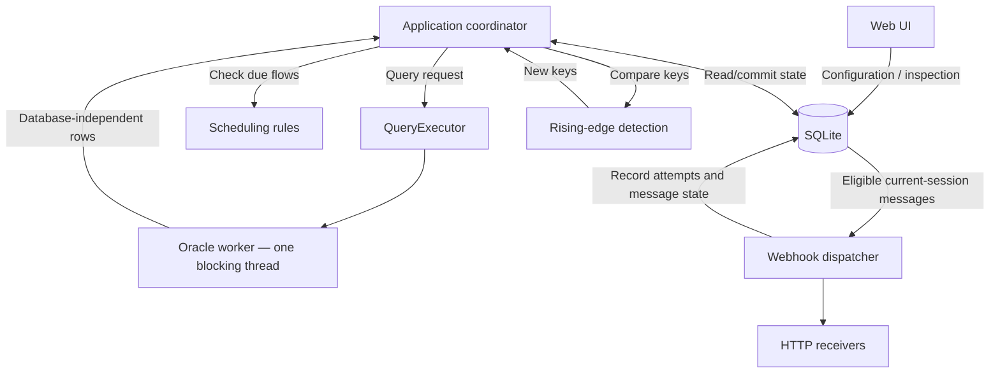
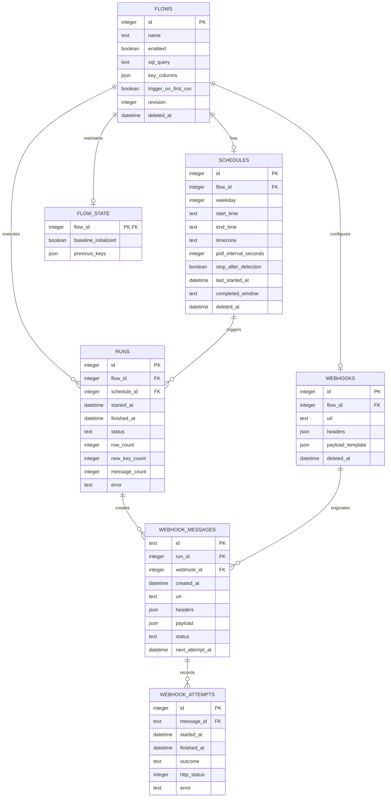

# Meerkat V1 — Technical Specification

**Version:** 1.0-draft  
**Date:** 20 November 2026  
**Status:** Agreed design baseline; implementation source included, build unverified  
**Primary scenario:** UC-001 — Shift wave readiness

> **Design objective:** Build the smallest version of Meerkat that can reliably execute UC-001, without architectural decisions that unnecessarily prevent UC-002 and UC-003 later.

This document consolidates the design decisions reached during the V1 scoping and architecture discussions. It distinguishes agreed V1 requirements, implementation guidance, deliberately deferred features, and details to finalize while coding. It is the implementation reference, not a description of the original Meerkat codebase.

## 1. Purpose and scope

Meerkat is a locally run application that periodically executes read-only SQL against a WMS database, identifies newly appearing query-result keys, and creates outgoing HTTP webhook messages. It maintains flow configuration, scheduling progress, rising-edge baselines, run history, and webhook delivery history in SQLite. It provides a server-rendered web UI for configuration and inspection.

Meerkat is **not** a generic workflow automation platform. It does not perform follow-up queries or downstream business processing. Once a webhook message is created, the delivery subsystem owns that message independently of the flow.

### 1.1 Primary scenario: UC-001 — Shift wave readiness

- Every Saturday, from **13:00 to 19:00 in Europe/Amsterdam**, poll the WMS at a configurable interval.
- The SQL query identifies the applicable shift itself (for example using Oracle `SYSDATE`); Meerkat supplies no query parameters.
- The query returns **zero rows until every wave belonging to that shift has reached at least the specified status**. Afterward it returns a row containing an identifier that is unique for that week's shift.
- When the shift identifier appears as a new key, create one webhook message. Initially, its static JSON payload communicates that all waves are active; a later receiving application can automate downstream work.
- **Stop polling for the remainder of that Saturday's window** as soon as the message has been durably created; do not wait for the HTTP request to succeed.
- Resume polling in the next week's window. Preserve the rising-edge baseline; the SQL's weekly unique identifier distinguishes successive events.

**Successful outcome:** UC-001 produces one message when readiness is first detected, does not continue polling that window, and runs again next Saturday. Failed HTTP requests follow the configured session-local retry policy.

### 1.2 Foreseeable later scenarios (not V1 acceptance requirements)

- **UC-002 — Stock issues:** monitor a set of keys and notify when previously absent issues appear. A removed key that reappears counts as new.
- **UC-003 — Employee activity:** monitor each employee's current activity and report changes to tracked values, potentially as a periodic batch.

The V1 architecture should not *prevent* these additions, but it must not implement their unused feature sets in anticipation.

## 2. Terminology and invariants

| Term | Definition |
|---|---|
| **Flow** | One SQL query, its identity-column configuration, and the associated event-detection behavior. |
| **Schedule** | The rule allowing a flow to run within recurring weekly time windows and at a polling interval. V1 permits one active schedule per flow. |
| **Run** | A single Oracle query execution and evaluation, including its result and diagnostic record. |
| **Key** | The typed tuple of one or more selected SQL result columns uniquely identifying a row. |
| **Baseline** | The set of keys from the **previous successful query execution**, persisted across restarts. |
| **Rising edge** | A key in the current successful result that was absent from the preceding baseline. |
| **Webhook configuration** | Destination URL, HTTP headers, and static JSON body associated with a flow. |
| **Webhook message** | An immutable snapshot of an outgoing HTTP request created by a run. |
| **Delivery attempt** | One actual attempt to send a webhook message, including its outcome. |
| **Window** | A specific occurrence of a schedule, uniquely identified by its scheduled local start and schedule ID. |

**Core invariants:**

1. A failed query or failed evaluation never advances the baseline.
2. On a successful evaluation, the baseline becomes the *entire* current set of keys, not a history of all keys ever seen.
3. Baseline advancement, successful run completion, webhook message insertion, and optional window completion happen in one SQLite transaction.
4. Every webhook message's URL, headers, and body are snapshotted when created and remain immutable across retries.
5. Existing webhook messages are unaffected by editing, disabling, or soft-deleting their originating flow or webhook configuration.
6. An Oracle flow cannot execute twice concurrently; queued missed polls do not accumulate.
7. On startup, previously `pending` or `sending` webhook messages are interrupted and **never automatically resumed**.
8. One running Meerkat instance owns the local SQLite database; concurrent instances against the same database are not supported.

## 3. Functional requirements

### 3.1 Configuration and Oracle access

- **FR-01 — Single Oracle account.** Load one Oracle connection descriptor, username, and password from environment variables. Every flow uses this account. No Oracle-connection management pages or SQLite connection records. A future pool may contain multiple connections using the same account.
- **FR-02 — One query per flow.** Each flow executes exactly one user-configured, read-only Oracle SQL query. No query parameters, follow-up SQL, condition expressions, or multi-step automation.
- **FR-03 — Query safety.** Apply read-only access/transactions, timeouts, result-size limits, and safe result conversion. Use a least-privilege Oracle user. A failed or incomplete result must never be mistaken for an empty successful result.
- **FR-04 — Persistent configuration.** Users can create, view, edit, enable, disable, and soft-delete flows, including their schedule and webhook. Changes survive restarts.
- **FR-05 — Query testing.** A user can execute a query on demand, inspect rows and column names, and choose identity columns. A test is read-only and must not update baselines, complete windows, or create webhook messages.

### 3.2 Rising-edge detection

- **FR-06 — One V1 detection mode.** Detect rising edges *per row key*: `new_keys = current_keys − previous_keys`. Ignore changes in non-key columns. Support composite keys.
- **FR-07 — Disappearance and reappearance.** A key removed from one successful result and present again in a later successful result generates a new rising edge.
- **FR-08 — Persistent baseline.** Persist the current key set after every successful evaluation, including an empty set. Distinguish an initialized empty baseline from a never-initialized baseline.
- **FR-09 — First successful execution.** Default: establish a baseline without emitting events. Optional flow setting: treat first observed keys as new and emit an event immediately. UC-001 will use the immediate-trigger setting.
- **FR-10 — Edits affecting detection.** Warn before changes to SQL or key identity; default to resetting the baseline, but permit retaining it. Use a flow configuration revision to prevent in-flight work from committing against changed configuration.

### 3.3 Scheduling

- **FR-11 — Weekly window.** Configure a weekday, local start/end time, IANA timezone, and polling interval. V1 supports one active schedule per flow. UC-001: Saturday 13:00–19:00, Europe/Amsterdam.
- **FR-12 — Stop after detection.** Optionally mark the active window complete after at least one rising edge has resulted in a committed webhook message. Completion does not depend on HTTP success.
- **FR-13 — Window recurrence.** At the next week's window, polling becomes eligible again. Do **not** reset the baseline simply because a new window opens.
- **FR-14 — No catch-up queue.** Only run flows eligible at the time capacity is available. Missed poll opportunities and entirely missed windows are skipped.
- **FR-15 — No overlap.** Only one in-flight execution per flow. The first poll in a new window can run as soon as capacity is available; subsequent polls respect the configured interval.
- **FR-16 — Late completion.** A query started within its window may finish and create webhook messages after that window's end.
- **FR-17 — Restart behavior.** Reload persisted schedule progress and completed-window identity. A restart during an already-completed window must not resume its polling.

### 3.4 Webhook construction and delivery

- **FR-18 — V1 message creation.** If a run detects one or more rising-edge keys, create **exactly one** webhook message using the configured **static JSON** body. If there are no rising edges, create none.
- **FR-19 — Request settings.** V1 sends HTTP POST with JSON, configurable URL and headers, and a request timeout. Redirects are disabled. Support HTTPS destinations and HTTP on loopback for local programs.
- **FR-20 — Immutable snapshot.** Persist message URL, headers, body, originating run, and webhook configuration reference at message creation. Retries send the saved request, not a newly rendered or reconfigured request.
- **FR-21 — Delivery history.** The dispatcher owns message lifecycle; `webhook_attempts` records each attempted HTTP request, including attempts that begin but do not finish.
- **FR-22 — Session-local retries.** Use configurable application-wide maximum retries and bounded exponential backoff. `WEBHOOK_MAX_RETRIES` counts retries **after** the initial attempt. On exhausting retries, mark the message `exhausted`.
- **FR-23 — Restart safety.** At startup, atomically change old `pending` and `sending` messages to `interrupted` and unfinished attempts to `interrupted`, before accepting new delivery work. Do not automatically resend these messages, even days later.
- **FR-24 — Independent lifecycle.** Changes to, or deletion of, a flow or webhook configuration never cancel an already generated message. No manual resend/cancel controls in V1.
- **FR-25 — Stable idempotency identifier.** Each message has a stable identifier supplied to receivers in a reserved header; repeated attempts use the same value. Exactly-once processing is **not** guaranteed.

### 3.5 Observability and UI

- **FR-26 — Persistent run history.** Record execution start/end, status, errors, row count, newly observed key count, and number of messages generated. A successful query returning zero rows is a success.
- **FR-27 — Persistent message history.** Show each webhook message's current lifecycle status, request snapshot, and historical delivery attempts.
- **FR-28 — Relationship-driven navigation.** Provide direct links among flow, runs, generated messages, and delivery attempts, including links to appropriately filtered overview pages. Display related records inline where practical.
- **FR-29 — Server-rendered UI.** Make a focused, locally bound web UI with ordinary forms and minimal JavaScript; no standalone dashboard or authentication system in V1.

## 4. Architecture and runtime

### 4.1 Cargo workspace

Seven focused crates, following the [Google Rust Style Guide](https://google.github.io/styleguide/rustguide.html), with no speculative generic frameworks:

| Crate | Responsibility |
|---|---|
| `meerkat-core` | Shared query-result and key types, rising-edge logic, small `QueryExecutor` interface. No Oracle, SQLite, or HTTP dependencies. |
| `meerkat-schedule` | Pure weekly-window and poll-eligibility calculations; accepts time as an argument. |
| `meerkat-oracle` | Single-account connection setup, blocking Oracle worker, read-only SQL execution, result conversion and limits. |
| `meerkat-store` | SQLite migrations, CRUD, state, run/message/attempt history, atomic transactions. |
| `meerkat-webhook` | Static JSON validation, HTTP request sending, retry math and delivery worker behavior. |
| `meerkat-web` | Server-rendered routes, forms, templates and presentation. |
| `meerkat` | Single executable, application coordinator, runtime startup/shutdown, dependency wiring. |

The crate split is provisional: merge or extract crates during implementation if actual code responsibilities justify it. The web UI and scheduler remain separate crates as agreed. Avoid circular dependencies; the application crate composes the adapters.

### 4.2 Component interaction



- **One process**, with an async web server/coordinator/dispatcher and an isolated blocking Oracle worker. SQLite work must not block the web server's async runtime.
- **Capacity-driven coordination:** when Oracle execution capacity becomes available, the coordinator selects a currently eligible flow and dispatches its query. The scheduling crate is a pure rules library; the Oracle worker does not pull from or know about the scheduler.
- **No persisted Oracle-job queue.** Skipped polling opportunities do not create backlog. A dispatcher may poll SQLite for pending webhook messages; a notification wake-up is optional.
- **Future parallel Oracle workers:** keep the executor boundary independent of worker count and ensure that each flow still has at most one concurrent execution. No worker pool is needed in V1.
- **Testing:** implement a small `QueryExecutor` interface that can be backed by a fake executor. Automated tests exercise orchestration against the fake; Oracle-specific integration testing is primarily manual.

## 5. SQLite logical data model

SQLite is used for configuration, persisted rising-edge and schedule state, execution history, and delivery state. The application stores webhook URLs and headers **in plaintext**; there is no encryption or key-management subsystem. The Oracle password remains outside SQLite in environment variables.

### 5.1 Entity-relationship diagram



### 5.2 Table responsibilities

| Table | Ownership and role | Constraints / notable fields |
|---|---|---|
| `flows` | Query + detection configuration | `id`, `name`, `enabled`, `sql_query`, `key_columns` JSON, `trigger_on_first_run`, `revision`, `deleted_at` |
| `schedules` | Weekly schedule configuration **and** runtime progress | `flow_id`, weekday/start/end/timezone/interval, stop flag, `last_started_at`, `completed_window`, `deleted_at`; one **active** schedule per flow |
| `webhooks` | Configured destination and static JSON payload | `flow_id`, URL, headers JSON, `payload_template` (static JSON in V1), `deleted_at`; one **active** webhook per flow |
| `flow_state` | Persistent per-flow rising-edge state | `flow_id` (PK and FK), `baseline_initialized`, `previous_keys` as canonical JSON key tuples |
| `runs` | Individual query executions and outcomes | flow and schedule FKs, timestamps, status, row/new-key/message counts, error |
| `webhook_messages` | Immutable outgoing requests, mutable delivery *status* | run/webhook FKs, request snapshot, `status`, `next_attempt_at` |
| `webhook_attempts` | Auditable individual HTTP attempts | message FK, timestamps, `outcome`, optional HTTP status and error |

Use foreign keys and indexes appropriate to the query paths. **Partial unique indexes** on `schedules(flow_id)` and `webhooks(flow_id)` where `deleted_at IS NULL` enforce one active child record while preserving soft-deleted versions. Historical runs, messages and attempts retain their relationships. `flows`, `schedules`, and `webhooks` use `deleted_at`; other tables do not need soft delete.

**JSON baseline storage:** Start with a single `flow_state.previous_keys` JSON array of typed, canonical composite keys. It is simple for V1; a normalized key table or tracked-value storage can be added only if actual requirements warrant it.

**Run counters:** Use `row_count`, `new_key_count`, `message_count`; do not name `new_key_count` merely `event_count`, because later detection types may produce different kinds of events.

**Flow revisions:** Changes to evaluation-relevant configuration must bump the flow revision, including changes made through related schedule/webhook configuration where they affect in-flight execution. Stale runs cannot commit a baseline or messages under a different revision.

## 6. Scheduling and execution lifecycle

### 6.1 Window eligibility

A schedule is eligible when its flow and schedule are active, current local time falls within the configured recurring weekly window, the current window is not recorded as completed, the flow is not already running or reserved, Oracle capacity is available, and its polling interval has elapsed (or it is the first poll of a new window).

- Define windows by schedule ID plus the **scheduled local window-start occurrence**, not by when Meerkat happened to launch.
- Treat start time as inclusive and end time as exclusive.
- If Meerkat launches partway through a noncompleted active window, allow polling when due. If the window has ended, wait until the next occurrence.
- Persist `completed_window` on the schedule itself. No separate `schedule_state` table and no weekly reset job.
- Respect last-started timestamps across same-window restarts. A new weekly window is eligible independently of last week's polling time.
- A query legitimately assigned within the window may complete after its end.
- Do not store or replay missed Oracle polling jobs.

### 6.2 Run lifecycle

1. **Select:** Coordinator selects an eligible flow when the one Oracle worker has capacity, marks it in flight, snapshots its effective configuration/revision and records a run start and schedule `last_started_at`.
2. **Query:** `QueryExecutor` performs read-only SQL and returns database-independent columns and typed rows or an error. It enforces timeout and size limits.
3. **Detect:** On success, derive the set of row keys and compare to `flow_state.previous_keys`. On a never-initialized baseline, either suppress new keys (default) or emit them (configured).
4. **Build:** If one or more rising-edge keys exist, validate/use the configured static JSON and prepare **one** outgoing request snapshot. A rendering/configuration failure is an evaluation failure; do not advance the baseline.
5. **Commit:** In one SQLite transaction, verify configuration revision is still current; update the whole baseline and initialization flag; finalize the run with counts; insert the webhook message if required; and mark the active window completed if stop-after-detection is configured and a message was created.
6. **Release:** Mark the flow no longer in flight; the independent dispatcher later sees the committed message.

**Error behavior:**

- Oracle query failure → record failure, preserve baseline and window eligibility; retry SQL at the next eligible poll.
- Configuration changed while running → mark the old result superseded, preserve current configuration/state, and do not create its messages.
- Crash during run → on startup mark an unfinished run interrupted; no partial baseline/message commit is possible.
- Duplicate or malformed identity keys and incomplete results must not silently advance a baseline. Exact validation choices are listed as implementation details to finalize.
- No flow is evaluated concurrently with itself, even if additional Oracle workers are introduced later.

## 7. Webhook construction and delivery

### 7.1 Request creation

V1 uses **static, user-authored JSON**, validated before saving. For example:

```json
{"text":"All waves are active"}
```

When a run detects at least one new key, construct one `webhook_messages` row that snapshots URL, headers, and JSON payload. No template placeholders are interpreted in V1. The configured field may retain the name `payload_template` as the future home for templating.

For later versions, payload construction may gain typed column references, event arrays, and iteration; those future additions should affect request construction but **not** the persisted message/attempt delivery protocol.

### 7.2 Message and attempt lifecycles

**Message status** answers: *What should Meerkat do with this outgoing message?*

| Status | Meaning | Eligible for automatic sending? |
|---|---|---|
| `pending` | New or awaiting the scheduled retry | Yes, when due in the current session |
| `sending` | An attempt is in progress | No |
| `delivered` | Successful HTTP 2xx response recorded | No |
| `exhausted` | Automatic retry allowance used | No |
| `interrupted` | Abandoned because Meerkat stopped/restarted | No |

A future manual-cancel feature may introduce `cancelled`; it is not necessary in V1.

**Attempt outcome** answers: *What happened to this one HTTP request?*

| Outcome | Meaning |
|---|---|
| `in_progress` | Started, no recorded result yet |
| `succeeded` | Received an accepted success response |
| `failed` | Received an unsuccessful response or transport/timeout error |
| `interrupted` | Application ended without recording a result; remote result unknown |

An HTTP status code alone is insufficient: connection errors, timeouts, and interruptions often have no HTTP response. Therefore both `webhook_messages.status` and `webhook_attempts.outcome` are required and represent different facts.

**Dispatch cycle:**

1. Select one current-session `pending` message whose `next_attempt_at` is due.
2. In one SQLite transaction, set message status `sending` and insert an `in_progress` attempt.
3. Execute one HTTP POST with its immutable request snapshot and stable idempotency header.
4. In one SQLite transaction, mark the attempt succeeded/failed and the message delivered/pending/exhausted; set `next_attempt_at` on a retry.
5. Repeat sequentially. Never send two attempts for the same message simultaneously.

**Retry policy:** Application-wide environment settings, proposed defaults (subject to implementation confirmation): `WEBHOOK_MAX_RETRIES=5`, initial delay 30 seconds, exponential backoff capped at 30 minutes, configurable HTTP timeout. Five retries means at most **six total** HTTP attempts.

**Startup:** Before starting the delivery worker, atomically mark previous-session `pending`/`sending` messages `interrupted`, and unfinished attempts `interrupted`. Messages created **after startup** may be dispatched. Startup must not reactivate old messages or cause old requests to be sent unexpectedly. Because delivery outcomes can be ambiguous, neither exactly-once delivery nor guaranteed delivery is promised.

**Isolation:** The delivery worker reads only the outbox and attempt records plus global retry configuration. It never consults the current flow enabled/deleted state. Flow deletion does **not** cancel or edit previously created messages.

## 8. Web UI and navigation

Use server-rendered HTML with limited JavaScript; default web bind address is `127.0.0.1`. The interface should make relationships visible and navigable without manual searches.

| Page | Route | Contents |
|---|---|---|
| Flows overview | `/flows` | Flow names, enabled state, schedule, current progress, last execution/errors |
| Create flow | `/flows/new` | SQL, key selection, schedule, baseline behavior, webhook URL/headers/static JSON |
| Flow details/edit | `/flows/:id` | Configuration, test query, baseline/schedule state, directly linked runs/messages |
| Runs overview | `/runs` | Status, durations, row/new-key/message counts; `?flow_id=` filtering |
| Run details | `/runs/:id` | Execution details/errors and generated message list or link to `?run_id=` |
| Webhook Messages overview | `/messages` | Message status, destination, attempts count; filter by flow/run/status |
| Message details | `/messages/:id` | Full immutable request snapshot, parent run, inline attempt history |
| Delivery Attempts overview | `/delivery-attempts` | Time, HTTP result/outcome, duration, error; filter by flow/message |

Do **not** add a standalone delivery-attempt details page unless information grows beyond what is cleanly shown inline. No independent dashboard; `/` can redirect to `/flows`. No V1 manual cancel, resend, generic admin settings page, or Oracle-connection UI.

**Navigation principle:** Identifiers link to their record pages, related counts link to pre-filtered lists, and parent/child records are shown inline whenever practical. A user must be able to navigate from **flow → runs → generated messages → delivery attempts**, and in reverse, without looking up IDs manually. Filters use bookmarkable query parameters and may be combined. Paginate potentially unbounded history lists.

**Editing:** Warn before evaluation-affecting edits and offer baseline reset (default) versus retention. Query testing must not mutate runtime state.

## 9. Security, operations, and limits

- One read-only, least-privilege Oracle account; use environment variables for connection settings and password.
- Plaintext webhook URLs and headers in SQLite are an **accepted V1 risk**; protect database file permissions and avoid logging complete tokens or sensitive payloads.
- Bind the unauthenticated web UI to loopback by default. Local receiving services may use `127.0.0.1`; loopback inside containers has different networking semantics.
- Apply HTTP request timeouts, disable redirects, and reserve internally managed headers (especially idempotency and content type) to avoid collisions.
- Validate SQL enough to enforce intended read-only behavior, and enforce query/result limits so a bad query cannot monopolize execution indefinitely. Database privileges remain the final safeguard.
- Use SQLite transactions and foreign keys. Block concurrent Meerkat processes from modifying the same database; multiple-instance coordination is outside V1 scope.
- Preserve historical data when soft-deleting flows/schedules/webhooks. Establish a simple housekeeping plan when real usage reveals storage needs; do not introduce an elaborate retention service prematurely.

## 10. Verification and acceptance

### 10.1 Automated testing priorities

| Area | Minimum cases | Test mechanism |
|---|---|---|
| Rising edges | first baseline modes; new/reappearing keys; unchanged keys; non-key changes ignored; composite identities; empty successful query; failed query preserves baseline | Pure unit tests |
| Scheduling | boundaries; recurrence; completed windows; late completion; mid-window restart; no catch-up; no overlapping executions; timezone/DST cases | Deterministic unit tests with injected times |
| SQLite + coordinator | atomic baseline/run/message/window commit; rollback; stale revision rejection; soft-deletion history; restart recovery | Integration tests using temporary SQLite and fake `QueryExecutor` |
| HTTP dispatcher | send-state/attempt atomicity; 2xx/fail/timeout; retry delays/limit; immutable payload; interrupted startup; no double send | Local HTTP test server and SQLite integration tests |
| Web UI | flow CRUD; query test does not mutate state; validation; baseline-reset warning; URL filters and contextual links | Handler/integration tests where practical |

**Oracle automated tests:** Keep them at an absolute minimum, ideally zero live-Oracle integration tests. Use the `QueryExecutor` fake for most automated testing. Small deterministic value-conversion unit tests are acceptable where they add real value. Verify the actual Oracle driver/connection and WMS query behavior manually.

Use `cargo fmt --check`, `cargo clippy`, and `cargo test` on the workspace as quality gates.

### 10.2 UC-001 release acceptance

- [ ] Configure the single Oracle account via environment variables.
- [ ] Create, test, and enable the wave-readiness flow through the UI.
- [ ] Set Saturday 13:00–19:00 in Europe/Amsterdam with a polling interval, stop-after-detection enabled, and immediate first-run triggering.
- [ ] Select the shift identifier as the rising-edge key; validate an empty query result and a later unique weekly key.
- [ ] Configure and validate the static Teams JSON webhook payload.
- [ ] Verify empty results continue polling and do not create messages.
- [ ] Verify the first new shift key creates exactly one webhook message and completes the window.
- [ ] Verify that a successful detection stops Oracle polling even if the webhook fails.
- [ ] Verify HTTP failures record attempts and retry within configured limits during the current session.
- [ ] Verify restart interrupts old pending/sending messages and does not resend them.
- [ ] Verify restarting within a completed window does not reopen the window.
- [ ] Verify next Saturday's window starts normally and the new weekly key is detected while the baseline is preserved.
- [ ] Verify links and filtering from flow to runs, messages, and delivery attempts.
- [ ] Verify a query started before 19:00 may finish and commit after 19:00.
- [ ] Perform a manual smoke test against the real Oracle/WMS environment.

## 11. Explicitly deferred functionality

| Feature | Why deferred / compatible future direction |
|---|---|
| Continuous interval schedules | Needed for UC-002/UC-003, not UC-001. Extend scheduling rules without changing coordinator ownership. |
| General cron expressions and multiple schedules per flow | Not needed for the Saturday window. Keep separate `schedules` table; one active schedule per flow in V1. |
| Reset baseline at each new schedule window | Current query already returns a unique weekly shift key; add a baseline policy later. |
| Value-change tracking | UC-003 requires keyed value comparison; keep key identity distinct from tracked values. |
| Conditional expressions | Later filter events (e.g., shortage increased) without moving WMS business logic into V1. |
| Multiple detection rules and webhook actions per query | Existing separation between query, event construction, and request snapshots leaves room for later routing. |
| Other trigger types such as `always` | No V1 use case. |
| Per-row versus batch webhook modes | V1 makes one message for all new keys in an execution; later expose grouping modes. |
| Dynamic JSON placeholders and collection loops | Keep `payload_template` configuration point; introduce template engine only when needed. Avoid unnecessary full-expression frameworks. |
| Manual retry/resend/cancel | Future actions on messages, independent of flow deletion. |
| Additional database connectors / multiple Oracle workers | `QueryExecutor` boundary and capacity-driven coordinator enable later additions; V1 uses one Oracle account/worker. |
| Full authentication, team permissions, dashboard analytics | Not required for localhost-first V1. |

## 12. Implementation details to resolve, not new product requirements

The following were **not fully decided** in the design discussions and should be resolved with the smallest defensible implementation rather than silently treated as agreed requirements:

1. **Identity validation:** exact behavior for NULL key fields, duplicate identities, Oracle value normalization, and numeric/timestamp canonicalization. Prefer explicit errors over silently corrupted baselines.
2. **Window edge cases:** how the local-time scheduler handles daylight-saving gaps/overlaps, and whether to reject windows crossing midnight in V1. UC-001's Saturday afternoon window avoids these cases.
3. **Operational defaults:** Oracle query timeout, result-size limit, HTTP timeout, dispatcher polling frequency, and final retry-backoff defaults.
4. **Lifecycle details:** graceful shutdown ordering, how to enforce the single-instance rule, and how a manual query test shares Oracle worker capacity without triggering the production coordinator.
5. **History housekeeping:** retention/storage caps for runs and attempts without deleting active outbox state.
6. **Historical query visibility:** whether to snapshot SQL into each run for later inspection; without a snapshot, the UI must not represent current SQL as the exact SQL used for an older run.
7. **Reserved request headers and outbound URL validation:** ensure coherent defaults while permitting the agreed loopback use cases and HTTPS webhooks.

When one of these choices materially changes a user's expected behavior, confirm it explicitly before coding that behavior. Otherwise prefer the simplest option consistent with the invariants above.

---

**Scope-control rule:** A feature belongs in V1 only if it is necessary for UC-001, essential for its agreed reliability and security behavior, or a specifically accepted low-cost usability improvement. Deferred features may influence clean boundaries but must not create unused subsystems in V1.
